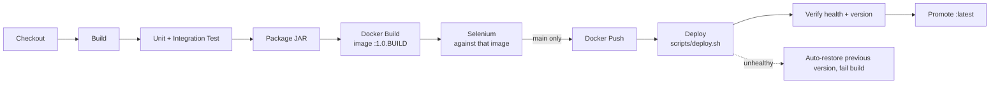

# 🏋️ Workout Plan Management System

A full-stack DevOps college project demonstrating the complete software delivery lifecycle — from a Spring Boot web application through containerisation, CI/CD, configuration management, automated testing, and rollback.

---

## Table of Contents

- [Overview](#overview)
- [Architecture](#architecture)
- [Technology Stack](#technology-stack)
- [Features](#features)
- [Local Development](#local-development)
- [Running with Docker Compose](#running-with-docker-compose)
- [Jenkins CI/CD Pipeline](#jenkins-cicd-pipeline)
- [Ansible Provisioning](#ansible-provisioning)
- [Testing](#testing)
- [Rollback](#rollback)
- [Default Credentials](#default-credentials)
- [API / Endpoints](#api--endpoints)
- [Project Structure](#project-structure)

---

## Overview

The **Workout Plan Management System** (FitFlow) is a web application that lets fitness trainers create, manage, and publish workout plans through a structured role-based approval workflow. An admin dashboard provides real-time statistics across plan statuses and difficulty levels.

---

## Architecture

```
Browser
  │
  ▼
Spring Boot (Thymeleaf MVC)  <── Spring Security (TRAINER / ADMIN)
  │
  ▼
WorkoutPlanService  (business rules, status-transition guard)
  │
  ▼
WorkoutPlanRepository  (Spring Data JPA)
  │
  ▼
MySQL 8 (Docker volume: mysql_data)
```

### Status Workflow

```
DRAFT ──► SUBMITTED ──► APPROVED ──► PUBLISHED
  ▲             │
  └─────────────┘  (admin reject / return for revision)
```

| Transition | Allowed Roles |
|---|---|
| DRAFT → SUBMITTED | Plan owner (TRAINER or ADMIN) |
| SUBMITTED → APPROVED | ADMIN only |
| APPROVED → PUBLISHED | ADMIN only |
| SUBMITTED → DRAFT | ADMIN only (reject/revise) |

---

## Technology Stack

| Layer | Technology |
|---|---|
| Language | Java 21 |
| Framework | Spring Boot 3.2.5 |
| ORM | Spring Data JPA / Hibernate |
| Database | MySQL 8 (prod) / H2 (tests) |
| Templating | Thymeleaf + Spring Security dialect |
| Authentication | Spring Security (form login) |
| Build | Maven 3.9 |
| Container | Docker (multi-stage) + Docker Compose |
| CI/CD | Jenkins declarative pipeline |
| Config Mgmt | Ansible 2.x (4 roles) |
| Testing | JUnit 5 · Mockito · TestNG · Selenium 4 |
| Monitoring | Spring Boot Actuator (/actuator/health) |

---

## Features

- Full CRUD — create, view, edit, and delete workout plans
- Role-based access — TRAINER and ADMIN roles with distinct permissions
- Status workflow — four-stage approval pipeline with enforced transitions
- Search and filter — full-text keyword search + status/difficulty filters
- Dashboard — live statistics: total plans, counts per status, counts per difficulty
- Validation — server-side bean validation on all inputs
- Error pages — custom 400, 404, 500 pages
- Health endpoint — /actuator/health for Docker/Jenkins health checks
- Automated tests — unit, integration, and Selenium end-to-end

---

## Local Development

### Prerequisites

- Java 21+
- Maven 3.9+
- MySQL 8 running locally (or use Docker Compose below)

### Configure the database

```sql
CREATE DATABASE workout_db;
CREATE USER 'workout_user'@'localhost' IDENTIFIED BY 'workout_pass';
GRANT ALL ON workout_db.* TO 'workout_user'@'localhost';
```

### Run the application

```bash
mvn spring-boot:run
```

The application starts on **http://localhost:8080**.

---

## Running with Docker Compose

Secrets are **never** stored in the repository. Create a `.env` from the template and change every value:

```bash
cp .env.example .env        # then edit: DB_PASSWORD, DB_ROOT_PASSWORD, APP_ADMIN_PASSWORD, APP_TRAINER_PASSWORD
```

```bash
# Build from source and start MySQL + application (development)
docker compose -f docker-compose.yml -f docker-compose.build.yml up -d --build --wait

# Run a published/pre-built image (what Jenkins and Ansible do)
APP_IMAGE=devopsproject/workout-plan-system APP_VERSION=1.0.42 docker compose up -d --wait

docker compose logs -f app     # follow logs
docker compose down            # stop (keeps the database volume); add -v to delete data
```

`docker compose up` fails immediately with a clear message if a required secret is missing.
The database port is **not** published to the host; only the app container can reach MySQL
(use `docker compose exec db mysql -u root -p` for admin access).

### Environment variables

| Variable | Default | Description |
|----------|---------|-------------|
| `DB_PASSWORD` | *(required in Docker)* | Application database password |
| `DB_ROOT_PASSWORD` | *(required in Docker)* | MySQL root password |
| `APP_ADMIN_PASSWORD` | *(required in Docker)* | Password of the seeded `admin` user |
| `APP_TRAINER_PASSWORD` | *(required in Docker)* | Password of the seeded `trainer` user |
| `DB_USERNAME` | `workout_user` | Application database user |
| `APP_IMAGE` | `devopsproject/workout-plan-system` | Image repository (set to your Docker Hub namespace) |
| `APP_VERSION` | `latest` | Image tag to run |
| `APP_PORT` | `8080` | Host port for the web UI |
| `DB_URL` | local MySQL | JDBC URL (set automatically by Compose) |
| `THYMELEAF_CACHE` | `true` | Set `false` while editing templates |

Outside Docker (`mvn spring-boot:run`) the seeded users fall back to the **development-only** passwords
listed under [Default Credentials](#default-credentials) and a warning is logged.

---

## Jenkins CI/CD Pipeline



* One image is built once, tagged `${DOCKER_NAMESPACE}/workout-plan-system:1.0.${BUILD_NUMBER}`; **that same image** is run by
  Selenium, pushed and deployed. No stage uses `|| true`, so a failed test, container start or health check fails the build and blocks later stages.
* Selenium runs against a throw-away stack (`docker-compose.ci.yml`): random credentials, random localhost port, no volumes.
  It is always torn down; screenshots, failsafe reports and container logs are archived.
* Deployment (`scripts/deploy.sh`) validates the compose file and image, starts the database, records the running version,
  replaces the app container, waits for the health check and, if the new version is unhealthy, restores the previous one.
  The container is recreated in place, so there is a **short outage** during the switch (not zero-downtime).
* `latest` is only pushed after the new version was deployed and verified.

### Required Jenkins credentials (created in Jenkins, never committed)

| ID | Type | Contents |
|----|------|----------|
| `docker-hub-credentials` | Username with password | Docker Hub user + access token |
| `workout-deploy-env` | Secret file | `DB_PASSWORD=`, `DB_ROOT_PASSWORD=`, `APP_ADMIN_PASSWORD=`, `APP_TRAINER_PASSWORD=` lines |

### Agent prerequisites

JDK 21, Maven 3.9+, Docker Engine with the Compose v2 plugin (`docker compose`), `curl`, `openssl`, Chrome/Chromium.
Plugins are listed in `jenkins/plugins.txt`. Use a **Multibranch Pipeline** (or set `BRANCH_NAME`) so the `main`-only stages run.
Set the `DOCKER_NAMESPACE` build parameter to your Docker Hub user.

### GitHub Actions

`.github/workflows/ci.yml` mirrors Jenkins: compile + tests, then build the image once, run Selenium against it and (on `main`)
push that tested image. Repository secrets: `DOCKER_HUB_USERNAME`, `DOCKER_HUB_TOKEN`.

---

## Ansible Provisioning

```bash
cd ansible
cp secrets.example.yml secrets.yml     # edit values, then: ansible-vault encrypt secrets.yml

ansible-playbook playbook.yml --syntax-check
ansible-playbook playbook.yml -e @secrets.yml --ask-become-pass                       # localhost
ansible-playbook playbook.yml -e target_hosts=app_servers -e @secrets.yml -e app_version=1.0.42   # remote
```

Roles: `preflight` (fails fast if secrets/inputs are missing) → `common` → `java` → `docker` (Engine + Compose plugin, skipped if present)
→ `app` (writes `.env` with mode 0600, installs compose file and `init.sql`, deploys with `community.docker.docker_compose_v2`,
verifies `/actuator/health` reports `UP`, and on failure restores the previously running version).
Re-running the playbook with no changes reports `changed=0`. Requires the `community.docker` and `community.general` collections
(included in the `ansible` PyPI package).

Roll back to an earlier build: `ansible-playbook rollback.yml -e rollback_version=1.0.41 -e @secrets.yml`.

---

## Testing

```bash
mvn test                # unit tests (Mockito) + repository tests (H2) + MockMvc security/HTTP tests (H2). No MySQL needed.
```

| Suite | What it proves |
|-------|----------------|
| `unit/WorkoutPlanServiceTest`, `WorkoutStatusTransitionTest` | CRUD, search, allowed/forbidden status transitions |
| `unit/WorkoutPlanAccessControlTest` | Service-layer authorization: trainers cannot view/edit/delete/transition others' plans; owner-scoped search and dashboard; admin sees all |
| `integration/WorkoutPlanRepositoryTest` | Queries and filters against H2 |
| `integration/WorkoutPlanSecurityIntegrationTest` | HTTP-level: 403 for cross-trainer URLs, trainer can submit own plan, trainer cannot approve, dashboard/search isolation, 404/400 status codes, public health endpoint |
| `selenium/WorkoutPlanSeleniumTest` | Browser journeys (login, create, search, edit, full workflow, dashboard) |

Selenium needs a running application and Chrome:

```bash
mvn test-compile failsafe:integration-test failsafe:verify \
    -Dapp.base.url=http://localhost:8080 -Dselenium.headless=true \
    -Dselenium.admin.password=<admin pw> -Dselenium.trainer.password=<trainer pw>
```

Screenshots are written to `target/selenium-screenshots/`.

---

## Rollback

```bash
# Roll back to the version recorded by the last successful deploy (.deploy/previous_version) ...
ENV_FILE=/path/to/secrets.env ./scripts/rollback.sh
# ... or to an explicit version
ENV_FILE=/path/to/secrets.env ./scripts/rollback.sh 1.0.41
```

Automatic recovery also happens inside `scripts/deploy.sh` (Jenkins) and the `app` Ansible role: if the new version never
reports healthy, the previously running version is started again and the run fails. Rollback restores the *application image*;
the schema is managed by Hibernate `ddl-auto=update`, so a rollback never reverts database changes.

---

## Default Credentials

Seeded on first start. **Development only** – override with `APP_ADMIN_PASSWORD` / `APP_TRAINER_PASSWORD`
(Docker Compose and Ansible require you to).

| Username | Dev password | Role |
|----------|--------------|------|
| `admin` | `Admin@123` | ADMIN |
| `trainer` | `Trainer@123` | TRAINER |

Seeding only creates a user that does not exist yet; changing the variables later does not change an existing user's password.

---

## API / Endpoints

| Method | Path | Description | Auth |
|---|---|---|---|
| GET | /login | Login page | Public |
| POST | /login | Authenticate | Public |
| GET | /logout | Logout | Authenticated |
| GET | /dashboard | Statistics dashboard | Authenticated |
| GET | /workouts | List / search / filter plans | Authenticated |
| GET | /workouts/new | Create plan form | Authenticated |
| POST | /workouts | Save new plan | Authenticated |
| GET | /workouts/{id} | Plan detail | Authenticated |
| GET | /workouts/{id}/edit | Edit plan form | Authenticated |
| POST | /workouts/{id} | Save updated plan | Authenticated |
| POST | /workouts/{id}/delete | Delete plan | Authenticated |
| POST | /workouts/{id}/status | Change plan status | Authenticated |
| GET | /actuator/health | Health check | Public |

---

## Project Structure

```
workout-plan-system/
├── .github/
│   ├── ISSUE_TEMPLATE/          # Bug report and feature request templates
│   └── workflows/
│       └── ci.yml               # GitHub Actions CI pipeline
├── ansible/
│   ├── group_vars/all.yml
│   ├── inventory.ini
│   ├── playbook.yml
│   └── roles/
│       ├── common/
│       ├── java/
│       ├── docker/
│       └── app/
├── docs/
│   ├── architecture.md
│   ├── api.md
│   └── deployment.md
├── jenkins/
│   └── plugins.txt
├── scripts/
│   ├── init.sql
│   └── rollback.sh
├── src/
│   ├── main/java/com/devops/workout/
│   │   ├── config/
│   │   ├── controller/
│   │   ├── dto/
│   │   ├── exception/
│   │   ├── model/
│   │   ├── repository/
│   │   ├── security/
│   │   └── service/
│   ├── main/resources/
│   │   ├── application.properties
│   │   ├── static/
│   │   └── templates/
│   └── test/
├── Dockerfile
├── Jenkinsfile
├── docker-compose.yml
└── pom.xml
```
